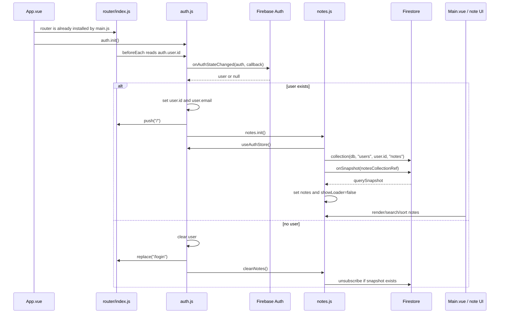

# Auth Notes Lifecycle Research

Goal: analyze the auth-driven notes lifecycle, starting from `src/App.vue` and following Firebase Auth state into `src/stores/auth.js`, `src/stores/notes.js`, route guards and the main notes UI. The repo map points here because auth initializes and cleans notes, notes reads auth to build the Firestore user path, and the two stores import each other.

## Scope

- Change ID: `auth-notes-lifecycle`
- Source map: `context/map/repo-map.md`
- Prompt package: `npx @przeprogramowani/10x-cli@latest get m4l3`
- Prompts used:
  - `.agents/prompts/m4l3-1-research-with-map.md`
  - `.agents/prompts/m4l3-2-ast-grep-verification.md`
- Entry points:
  - `src/main.js`
  - `src/App.vue`
  - `src/router/index.js`
  - `src/js/firebase.js`
  - `src/stores/auth.js`
  - `src/stores/notes.js`
  - `src/views/Main.vue`
  - `src/components/LoginForm.vue`
  - `src/components/RegisterForm.vue`
  - `src/components/AddElementForm.vue`
  - `src/components/EditElementForm.vue`
  - `src/components/PopUpDelete.vue`

## Method

This research follows the `m4l3-1-research-with-map` prompt with three focused sub-agent passes:

- Trace e2e: app bootstrap, auth state, notes subscription, Firestore and UI return path.
- Test gaps: executable coverage for methods and branches on the selected path.
- Blast radius: static coupling plus local git co-change signals.

The `m4l3-2-ast-grep-verification` prompt was then applied to structural claims in this report.

## Feature Overview

### Trace e2e

### Evidence

- `src/App.vue:21` calls `auth.init()` in `onMounted`, so Firebase Auth initialization starts from the app shell after mount.
- `src/main.js:7` injects the Vue Router into every Pinia store as `store.router`; this is why `auth.js` can call `this.router.push()` and `this.router.replace()`.
- `src/main.js:12` installs router and Pinia before mounting the app.
- `src/js/firebase.js:15`, `src/js/firebase.js:16` and `src/js/firebase.js:17` initialize Firebase app, Firestore and Auth clients.
- `src/stores/auth.js:14` defines `init()`, then `src/stores/auth.js:16` registers `onAuthStateChanged(auth, callback)`.
- On authenticated state, `src/stores/auth.js:18` and `src/stores/auth.js:19` write `user.id` and `user.email`; `src/stores/auth.js:20` redirects to `/`; `src/stores/auth.js:21` calls `notes.init()`.
- On unauthenticated state, `src/stores/auth.js:23` clears `user`; `src/stores/auth.js:24` redirects to `/login`; `src/stores/auth.js:25` calls `notes.cleanNotes()`.
- `src/components/LoginForm.vue:48` calls `storeAuth.loginUser(form)`; `src/stores/auth.js:43` delegates login to Firebase Auth.
- `src/components/RegisterForm.vue:61` calls `storeAuth.registerUser(form)`; `src/stores/auth.js:29` delegates registration to Firebase Auth.
- `src/stores/notes.js:4` imports `useAuthStore`, while `src/stores/auth.js:4` imports `useNotesStore`, creating a direct store-to-store cycle.
- `src/stores/notes.js:27` defines `init()`, reads `auth.user.id` at `src/stores/notes.js:29`, then creates the user-scoped Firestore collection at `src/stores/notes.js:31`.
- `src/stores/notes.js:35` starts a live Firestore subscription via `onSnapshot`; `src/stores/notes.js:41` replaces the local notes array and `src/stores/notes.js:42` clears the loader.
- `src/stores/notes.js:46` clears local notes, and `src/stores/notes.js:48` unsubscribes if a snapshot listener exists.
- `src/router/index.js:34` registers a global guard. It redirects users without `auth.user.id` away from non-login routes at `src/router/index.js:37`, and blocks logged-in users from the login route at `src/router/index.js:42`.
- `src/views/Main.vue:25` shows the loader while `notes.showLoader` is true; `src/views/Main.vue:63` reads the notes store; `src/views/Main.vue:70` computes the rendered notes list; `src/views/Main.vue:32` renders cards once `notes.showLoader` is false.
- Note mutations use the same module-level Firestore ref: `addNote()` writes through `setDoc` at `src/stores/notes.js:53`, `deleteNote()` through `deleteDoc` at `src/stores/notes.js:57`, and `editNote()` through `updateDoc` at `src/stores/notes.js:60`.
- UI mutation callers are direct: `src/components/AddElementForm.vue:58` calls add, `src/components/EditElementForm.vue:63` calls edit, and `src/components/PopUpDelete.vue:29` calls delete.

### Inference

- The app treats Firebase Auth state as the owner of the notes lifecycle. The notes subscription starts only after `onAuthStateChanged` returns a user and should stop when it returns null.
- The user-scoped path is implicit rather than passed as a parameter: `notes.init()` reaches back into `auth.user.id`. That makes the order of operations important: `auth.user.id` must be set before `notes.init()` runs.
- UI code assumes the notes store has already been initialized by auth. Components call `addNote`, `editNote`, `deleteNote` and `getItemById` without checking whether `notesCollectionRef` exists.
- Firestore live updates appear to be the intended UI refresh mechanism after add/edit/delete, because CRUD methods do not mutate `notes.notes` directly.

### Unknowns

- Firebase security rules are not present in this repo, so the client-side `users/{uid}/notes` path does not prove server-side isolation.
- There are no visible local tests or test scripts, so runtime behavior around auth timing, redirects and subscription cleanup is not covered by executable tests in this repo.
- The behavior before Firebase Auth resolves is fragile to timing: route guards read `auth.user.id`, but `auth.init()` runs in `App.vue` on mount and the auth callback is asynchronous.

## Technical Debt

### Confirmed Risks

- Direct store cycle: `auth.js` imports `notes.js`, and `notes.js` imports `auth.js`. This is a structural coupling around auth and notes lifecycle.
- Lifecycle side effects live in auth: auth state changes also perform router redirects and notes subscription management. This makes `auth.init()` responsible for authentication state, navigation and data loading.
- Module-level mutable Firestore state: `notesCollectionRef` and `getOnSnapshot` live outside the Pinia store state in `src/stores/notes.js:8` and `src/stores/notes.js:9`. They are shared by the module rather than explicit per store instance.
- Note mutations depend on prior initialization. `addNote`, `deleteNote` and `editNote` all use `notesCollectionRef`, but they do not guard against it being undefined.
- Route guards depend on a synchronously available `auth.user.id`, while Firebase Auth state arrives through `onAuthStateChanged`. This can produce redirect behavior before auth resolution is known.
- Edit flow assumes a note exists locally. `src/components/EditElementForm.vue:61` spreads `notes.getItemById(props.id)`; if the note is not loaded yet or the id is invalid, this can fail.
- Router access inside stores depends on a Pinia plugin contract from `src/main.js:7`; `auth.js` does not import router directly, but assumes `this.router` exists.
- Firebase config is hard-coded in `src/js/firebase.js:6`; `firebase.json` only configures hosting and does not include Firestore rules.

### Test Gaps

- `package.json` has no `test` script and no visible Vitest/Jest/Cypress/Playwright/testing-library dependency.
- No local `*test*` or `*spec*` files were found outside `node_modules`.
- Therefore, no automated tests were found during this pass for:
  - unauthenticated route redirect,
  - authenticated redirect away from login,
  - auth callback starting `notes.init()`,
  - logout clearing notes and unsubscribing,
  - note CRUD before/after notes initialization,
  - edit route when note data is not loaded,
  - `registerUser()`, `loginUser()` and `logoutUser()` success/catch branches,
  - `sortNote()` title, priority and fallback/date branches.

### Blast Radius

Changing this flow may require coordinated updates in:

- `src/main.js`: router injection into Pinia stores.
- `src/stores/auth.js`: auth callback, redirects, lifecycle side effects.
- `src/stores/notes.js`: user-scoped collection creation, snapshot listener, cleanup and CRUD methods.
- `src/router/index.js`: route guards and behavior while auth state is unresolved.
- `src/App.vue`: app-level initialization timing.
- `src/views/Main.vue`, `src/views/Edit.vue` and edit/delete/add/card/navbar components: assumptions about auth state, notes being loaded and mutation methods being ready.
- Firebase deployment/config outside this repo: security rules and hosted environment behavior.

Local git history supports this blast radius:

- `7b580aa` (`add auth firebase`, 2023-04-23) changed auth, notes, app shell, main, Firebase setup, login/register forms, navbar and main view together.
- `d983be0` (`add multiply users`, 2023-04-25) changed `auth.js`, `notes.js` and `Main.vue` together when notes became user-scoped.
- `8677509` (`beforeEach router`, 2023-04-25) changed `router/index.js` to add the guard.
- Pair co-change from the map/history: `notes.js + Main.vue` changed together 6 times; `Card.vue + notes.js` 8 times; `auth.js + notes.js` 2 times.

## Structural Claims To Verify

These claims should be checked with `ast-grep` when it is available. If an `ast-grep` query returns zero, confirm with `rg`.

- There is one `onAuthStateChanged` registration.
- `auth.js` and `notes.js` import each other directly.
- `notes.init()` is called from `auth.init()`.
- `notes.cleanNotes()` is called from `auth.init()`.
- `notesCollectionRef` is used by all Firestore note mutations.
- `getOnSnapshot` is only assigned in `getNotes()` and invoked in `cleanNotes()`.
- Route access logic depends on `auth.user.id`.

## RG Verification

This pass uses `rg` as the text-level cross-check required by the lesson. It is especially useful when an `ast-grep` pattern returns zero and we need to distinguish a real absence from a bad structural pattern.

| Claim | Status | Evidence |
| --- | --- | --- |
| There is one `onAuthStateChanged` registration. | Confirmed by `rg` | Import at `src/stores/auth.js:2`; callback registration at `src/stores/auth.js:16`. |
| `auth.js` and `notes.js` import each other directly. | Confirmed by `rg` | `src/stores/auth.js:4` imports `useNotesStore`; `src/stores/notes.js:4` imports `useAuthStore`. |
| `notes.init()` is called from `auth.init()`. | Confirmed by `rg` | `src/stores/auth.js:21`. |
| `notes.cleanNotes()` is called from `auth.init()`. | Confirmed by `rg` | `src/stores/auth.js:25`. |
| `notesCollectionRef` is used by all Firestore note mutations. | Confirmed by `rg` | Defined at `src/stores/notes.js:8`; set at `src/stores/notes.js:31`; used by snapshot at `src/stores/notes.js:36`, add at `src/stores/notes.js:53`, delete at `src/stores/notes.js:57`, edit at `src/stores/notes.js:60`. |
| `getOnSnapshot` is only assigned in `getNotes()` and invoked in `cleanNotes()`. | Confirmed by `rg` | Defined at `src/stores/notes.js:9`; assigned at `src/stores/notes.js:36`; invoked at `src/stores/notes.js:48`. |
| Route access logic depends on `auth.user.id`. | Confirmed by `rg` | Guard conditions at `src/router/index.js:37` and `src/router/index.js:42`; navbar also reads this at `src/components/Navbar.vue:51`. |
| Local app tests cover this lifecycle. | Obsoleted by `rg` | No project test/spec files were found outside `node_modules` in this pass. |

## AST-Grep Verification

`ast-grep` was run through `npx -p @ast-grep/cli ast-grep` after global installation failed on `/usr/local` permissions. The package version used was `ast-grep 0.44.1`.

| Claim | Status | Pattern | Evidence |
| --- | --- | --- | --- |
| There is one `onAuthStateChanged` registration. | Confirmed | `onAuthStateChanged($$$A)` | `src/stores/auth.js:16`. |
| `notes.init()` is called from `auth.init()`. | Confirmed | `$NOTES.init()` | `src/stores/auth.js:21`. |
| `notes.cleanNotes()` is called from `auth.init()`. | Confirmed | `$NOTES.cleanNotes()` | `src/stores/auth.js:25`. |
| Firestore note mutations use `notesCollectionRef`. | Confirmed | `doc(notesCollectionRef, $$$A)` | `src/stores/notes.js:53`, `src/stores/notes.js:57`, `src/stores/notes.js:60`. |
| Notes are loaded through one Firestore snapshot subscription. | Confirmed | `onSnapshot(notesCollectionRef, $$$A)` | `src/stores/notes.js:36`. |
| Access/user scoping depends on `auth.user.id`. | Confirmed | `auth.user.id` | `src/router/index.js:37`, `src/router/index.js:42`, `src/stores/notes.js:29`. |
| `auth.js` imports `notes.js`. | Confirmed | `import { useNotesStore } from '@/stores/notes.js'` | `src/stores/auth.js:4`. |
| `notes.js` imports `auth.js`. | Confirmed | `import { useAuthStore } from "@/stores/auth.js"` | `src/stores/notes.js:4`; the same pattern also matches `src/router/index.js:7`, which is expected because router also uses auth. |

One initial import pattern returned zero because it assumed double quotes while the file used single quotes. `rg` confirmed the import, and the corrected `ast-grep` pattern matched it. This is the exact zero-check rule from the lesson in practice.
