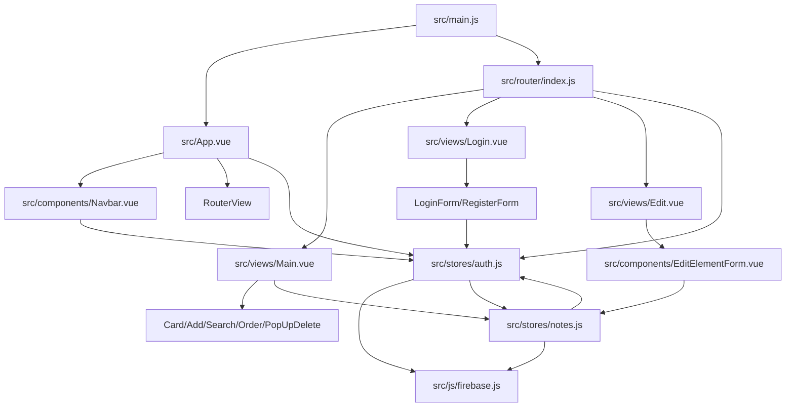

# Artifact 2: Structure

## Method

No dependency graph tool is installed in the project (`node_modules/.bin` contains `vite` and `eslint`, but not `dependency-cruiser` or `madge`). This artifact uses:

- import scan over `.vue` and `.js` files,
- direct reads of main store/router/bootstrap files,
- `npm run build` as a sanity check.

This is a lightweight static map, not a full dependency-cruiser report.

## Build Signal

`npm run build` succeeds with Vite. It emits a chunk-size warning:

- built JS bundle: `dist/assets/index-94bcedd4.js`, 518.15 kB minified, 135.83 kB gzip,
- Vite suggests dynamic imports or manual chunks if bundle size becomes a concern.

This warning is not urgent for a small app, but it is a useful note before adding more Firebase-heavy features.

## Main Layers

## Entry Points

| Entry | Role | Notes |
| --- | --- | --- |
| `src/main.js` | App bootstrap | Creates Pinia, injects router into every store via `markRaw(router)`, mounts Vue app. |
| `src/App.vue` | App shell | Renders `Navbar`, `RouterView`, `Footer`; calls `auth.init()` on mount. |
| `src/router/index.js` | Route and access control | Defines `/`, `/login`, `/stats`, `/edit/:id`, `/documentation`; guards non-login routes via auth store. |
| `src/js/firebase.js` | Runtime integration | Initializes Firebase app, Firestore and Auth. |

## Store Coupling

The most important structural finding is a store cycle:

- `src/stores/auth.js` imports `useNotesStore` and calls `notes.init()` / `notes.cleanNotes()` when auth state changes.
- `src/stores/notes.js` imports `useAuthStore` and reads `auth.user.id` to build `users/{uid}/notes` collection refs.

Evidence:

- `src/stores/auth.js:4`, `src/stores/auth.js:14-25`
- `src/stores/notes.js:4`, `src/stores/notes.js:27-32`

Why it matters:

- Auth, routing and Firestore subscription lifecycle are tied together.
- Changes to login/logout behavior can break note subscription cleanup.
- Changes to note initialization can break auth redirects or user-scoped Firestore paths.

## Data Flow

Primary authenticated notes flow:

1. `src/App.vue` calls `auth.init()` on mount.
2. `auth.init()` subscribes to Firebase Auth via `onAuthStateChanged`.
3. When a user exists, auth store sets `user.id`, redirects to `/`, and calls `notes.init()`.
4. `notes.init()` builds `collection(db, "users", userid, "notes")`.
5. `notes.getNotes()` subscribes through Firestore `onSnapshot`.
6. `Main.vue` reads `notes.notes`, filters it through local search state, and renders `Card.vue` for each note.
7. Add/edit/delete components call Pinia actions, which write to Firestore.

## Components With Store Access

| File | Store | Role |
| --- | --- | --- |
| `src/views/Main.vue` | notes | Main list composition, search filtering and popup state. |
| `src/components/AddElementForm.vue` | notes | Adds new notes. |
| `src/components/EditElementForm.vue` | notes | Edits/deletes one note by route param. |
| `src/components/PopUpDelete.vue` | notes | Deletes selected note after confirmation. |
| `src/components/Order.vue` | notes | Sorts note list. |
| `src/components/Navbar.vue` | auth | Shows logout when logged in. |
| `src/components/LoginForm.vue` | auth | Logs in user. |
| `src/components/RegisterForm.vue` | auth | Registers user. |

## Sensitive Areas

| Area | Why sensitive | Evidence |
| --- | --- | --- |
| `src/stores/auth.js` | Owns auth state, router redirects, notes lifecycle. | Imports Firebase Auth and notes store. |
| `src/stores/notes.js` | Owns Firestore collection ref, live subscription, CRUD and sorting. | Imports Firebase Firestore and auth store. |
| `src/router/index.js` | Guards all routes and sets document title. | Uses `useAuthStore()` in `beforeEach`. |
| `src/main.js` | Injects router into all stores. | `pinia.use(({store}) => { store.router = markRaw(router) })`. |
| `src/js/firebase.js` | Contains Firebase project config and exports runtime clients. | Initializes app, db, auth. |
| `src/views/Main.vue` | Coordinates most visible note workflow. | Imports five components and notes store. |

## Unknowns

- No full graph metrics (`Ca`, `Ce`, cycles) were produced because dependency-cruiser/madge is not installed.
- Static import scan can miss runtime coupling through Firebase, router navigation and Firestore listeners.
- The import scan saw `moment` in `Card.vue`, but it is commented out in source, so that is a regex false positive rather than a real dependency use.
- Firebase security rules are not present in this repo; user isolation is visible in client code but server-side enforcement is unknown.
