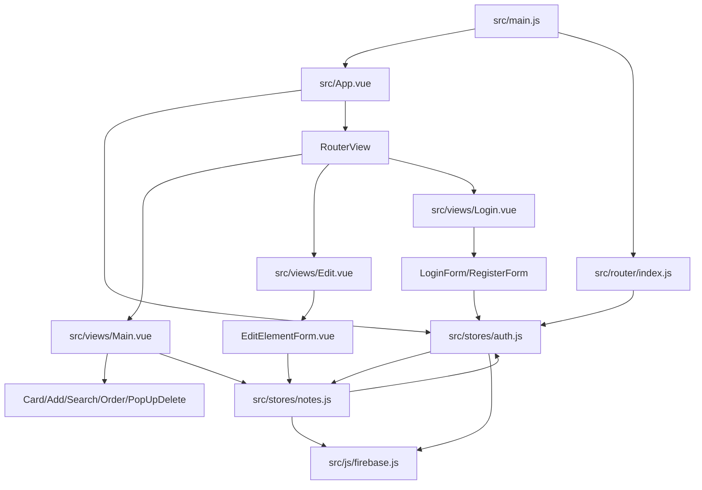

# Repo Map: Nodeballs

## TL;DR

Nodeballs is a small Vue 3 + Vite notes app using Pinia, Vue Router, Firebase Auth and Firestore. According to `artifact-1-territory.md`, the most active work happened around the notes UI and notes state: `Card.vue`, `src/stores/notes.js`, `Main.vue`, delete popup, navigation and app shell. According to `artifact-2-structure.md`, the load-bearing path is app bootstrap -> auth -> router -> notes -> Firebase, with a direct store cycle between `auth.js` and `notes.js`. According to `artifact-3-contributors.md`, the local Git history has one contributor, so contributor context is useful as questions to the original author rather than as team ownership. The highest caution before larger changes is the auth + notes lifecycle: login state, route guards, redirects, Firestore user scoping and live subscriptions are coupled. This map is based on a short historical window from 2023-03-20 to 2023-04-25, not on current activity.

## Terrain

| Area | Role on the map | Evidence | Caution |
| --- | --- | --- | --- |
| Notes UI | Main user-facing workflow | `artifact-1`: `Card.vue` 16 changes, `Main.vue` 12, `PopUpDelete.vue` 8; components area 69 changes | UI changes often touch store behavior and delete/edit/list flows. |
| `src/stores/notes.js` | Core data store | `artifact-1`: 13 changes; `artifact-2`: owns Firestore collection ref, live subscription, CRUD and sorting | Changes can affect persistence, live updates, sorting and user-scoped data. |
| `src/stores/auth.js` | Core auth lifecycle | `artifact-2`: owns auth state, redirects and notes lifecycle | Changes can affect login/logout, route flow and notes subscription cleanup. |
| `src/router/index.js` | Access-control entry | `artifact-1`: auth added late; `artifact-2`: guards non-login routes through auth store | Initial auth timing and route-name based checks need care. |
| `src/js/firebase.js` | Runtime integration | `artifact-1`: low churn but sensitive; `artifact-2`: initializes Firebase app, db and auth | Static map cannot verify deployed rules or runtime config. |
| Bootstrap/app shell | Wiring layer | `artifact-1`: `App.vue` 8 changes, `main.js` 5; `artifact-2`: router injected into stores | App startup, auth init and router availability are coupled. |

## Real Couplings

- `auth.js` <-> `notes.js`: direct store cycle. Evidence: `artifact-2-structure.md`. This is the main blast-radius warning because auth state starts/stops notes lifecycle, while notes reads auth to build the Firestore path.
- `Card.vue` + `notes.js`: frequent co-change. Evidence: `artifact-1-territory.md`, 8 shared commits. Treat card actions and note persistence as historically connected.
- `notes.js` + `Main.vue`: frequent co-change. Evidence: `artifact-1-territory.md`, 6 shared commits. The main screen and data store form the central user flow.
- `Card.vue` + `Main.vue`: frequent co-change. Evidence: `artifact-1-territory.md`, 6 shared commits. List composition and card display are a local UI cluster.
- `App.vue` + `main.js`: bootstrap coupling. Evidence: `artifact-1-territory.md`, 4 shared commits, and `artifact-2-structure.md` entry point notes.
- Firebase runtime coupling: `auth.js` and `notes.js` both depend on `src/js/firebase.js`. Evidence: `artifact-2-structure.md`. This static map does not prove deployed security rules.

## Risk Zones

| Zone | Why it is risky | Evidence source |
| --- | --- | --- |
| Auth + notes lifecycle | Auth initializes/cleans notes, notes reads auth for user-scoped Firestore refs, and the two stores import each other. | `artifact-2` |
| Route access | Router guard depends on auth store state and auth was introduced late in history. | `artifact-1`, `artifact-2`, `artifact-3` |
| Firestore data path | Notes are stored under `users/{uid}/notes`; client-side structure is visible, but server-side rules are outside the map. | `artifact-2`, `artifact-3` |
| Main notes UI | Most churn is around list/card/delete/search/order and those files co-change with the notes store. | `artifact-1`, `artifact-3` |
| Edit/delete flow | `EditElementForm.vue`, `Card.vue`, `PopUpDelete.vue` and `notes.js` appear together in activity and structure. | `artifact-1`, `artifact-2` |
| Build/dependencies | `package.json` changed 7 times and Vite build has a chunk-size warning. | `artifact-1`, `artifact-2` |

## Who To Ask

The local Git history has one contributor: `Sebastian <sebastianwuczkowski@gmail.com>` (`artifact-3-contributors.md`). There is no team ownership map in this clone, so the useful output is a question list:

- Auth and per-user notes: ask what should happen before Firebase Auth resolves.
- Auth/router ownership: ask whether redirects should live in `auth.init()` or in router guards.
- Store boundary: ask whether `notes.js` should know about `auth.js`.
- Firebase safety: ask where Firestore security rules and deployment process live.
- Product surface: ask whether `Stats.vue` and `Documentation.vue` are placeholders or real features.

## First Day

Read these in order. The order comes from the entry points in `artifact-2` and the activity/risk signals in `artifact-1`.

1. `README.md` - project setup and documentation baseline.
2. `package.json` - stack, scripts and dependency context.
3. `src/main.js` - app bootstrap and router injection into stores.
4. `src/App.vue` - shell and auth initialization.
5. `src/router/index.js` - route table and access guard.
6. `src/js/firebase.js` - Firebase app, Auth and Firestore clients.
7. `src/stores/auth.js` - auth state, redirects and notes lifecycle.
8. `src/stores/notes.js` - Firestore notes collection, live subscription and CRUD.
9. `src/views/Main.vue` - main note workflow composition.
10. `src/components/Card.vue`, `src/components/EditElementForm.vue`, `src/components/PopUpDelete.vue` - local UI cluster around edit/delete/display.

## What This Map Does Not Say

- It does not describe current development activity: the last 12 months have no commits in this clone, so `artifact-1` uses all available history.
- It does not include PRs, issues, production incidents or review discussion.
- It does not include full dependency graph metrics (`Ca`, `Ce`, instability, cycles) because dependency-cruiser/madge was not installed.
- It does not verify Firebase security rules or deployed hosting configuration.
- It does not prove that frequently co-changing files are architecturally coupled; co-change is a signal for further inspection.
- It does not recommend a refactor yet. The next lesson/session should choose one risk zone, probably auth + notes lifecycle, and run Deep Focus there.
